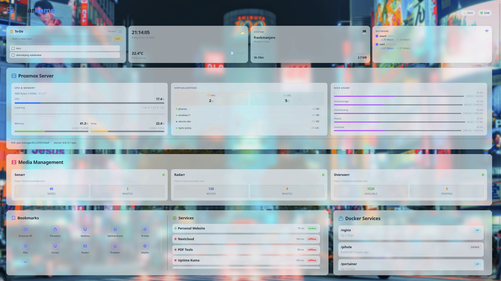
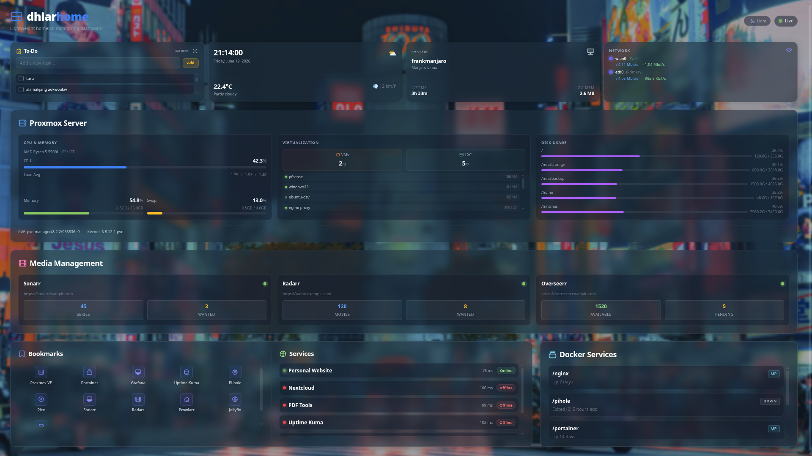

# dhiarhome — Live Demo

A **fully static, self-contained demo** of [dhiarhome](https://github.com/Alfar0nt/dhiarhome) — an ultra-lightweight, self-hosted homelab monitoring dashboard.

This branch (`demo-home`) is a **showcase-only build** designed to be hosted on **Cloudflare Pages**. There is **no backend, no database, and no API calls** — every metric is generated in the browser by a small client-side mock engine and changes every few seconds so the dashboard looks "live".

| Dark Mode | Light Mode |
|-----------|-----------|
|  |  |

> ⚠️ **Demo notice:** all values are simulated. Links and actions (bookmarks, media WebUI, Telegram, etc.) are non-functional and exist only to illustrate the real product. The real dashboard runs a Go backend — see the `main` / `develop` branches.

---

## What's simulated

- **Proxmox VE** — CPU, memory, swap, load average, multi-disk usage, PVE/kernel version, VM/LXC list with live status flips
- **Docker** — container list with up/down transitions
- **Web services** — online/offline transitions with fluctuating response times
- **Media services** — Sonarr / Radarr / Overseerr counters that slowly grow
- **Network** — per-interface RX/TX speeds with animated totals
- **Utility widgets** — live clock, weather, system info (hostname, OS, uptime, Go memory)
- **Bookmarks** — grid of links with icons
- **Interactive to-do** — add / toggle / edit / delete (in-memory, resets on reload)
- **Toast notifications** — pop up on state transitions (green = recovered, red = down)
- **Activity feed** — rolling log of recent events
- **Dark / light theme toggle** — persisted to `localStorage`

All updates are driven client-side by Alpine.js + vanilla JS. No `fetch`/XHR to any server.

---

## Run locally

Any static file server works:

```bash
# Python
python3 -m http.server 8080

# or Node
npx serve .
```

Then open `http://localhost:8080`.

---

## Deploy to Cloudflare Pages

1. Push this branch to GitHub.
2. In the Cloudflare dashboard → **Workers & Pages** → **Create** → **Pages** → **Connect to Git**.
3. Select the `dhiarhome` repository and the **`demo-home`** branch.
4. Build settings:
   - **Framework preset:** None
   - **Build command:** *(leave empty)*
   - **Build output directory:** `/` (repository root)
5. Deploy. The root `index.html` is served as the site.

> The demo is a single `index.html` plus `screenshots/` — no build step required.

---

## Project structure

```
dhiarhome/ (demo-home branch)
├── index.html              # The demo app (markup + Alpine bindings)
├── assets/
│   ├── app.js              # Client-side mock data engine (demoApp)
│   ├── alpine.min.js       # Self-hosted Alpine.js (no CDN)
│   ├── input.css           # Tailwind directives + custom styles (source)
│   └── tailwind.css        # Precompiled CSS (committed, built once)
├── screenshots/            # Dark / light previews
├── logo.png
├── package.json            # tailwindcss devDep + build:css script
├── tailwind.config.js      # content globs for class purging
├── .ai/                    # Project docs (PRD, TRD, APP-FLOW, DESIGN, IMPLEMENTATION-PLAN)
├── docs/                   # CHANGELOGS.md, DEPLOYMENT.md
└── AGENTS.md
```

## Rebuilding the CSS

The dashboard uses a **precompiled** Tailwind stylesheet (no Play CDN, better performance). If you add/remove utility classes in `index.html` or `assets/app.js`, regenerate `assets/tailwind.css`:

```bash
npm install        # once
npm run build:css  # recompile assets/tailwind.css
```

Commit the regenerated `assets/tailwind.css` so Cloudflare Pages needs no build step.

---

## The real project

The production dashboard is written in **Go** with **HTMX** + **Alpine.js** + **Tailwind CSS** and runs as a single ~14 MB binary (Docker or bare metal):

- Real Proxmox VE API, Docker Engine API, Sonarr/Radarr/Overseerr, `/proc/net/dev` sampling
- Background pollers + in-memory cache (sub-5 ms `/status` responses)
- Telegram notifications with cooldown and silent hours
- Security hardening (CSP, SSRF protection, rate limiting)

See the [`main`](https://github.com/Alfar0nt/dhiarhome/tree/main) or [`develop`](https://github.com/Alfar0nt/dhiarhome/tree/develop) branch.

---

## License

[MIT](LICENSE) — Copyright (c) 2026 Dhiar Harianto.
